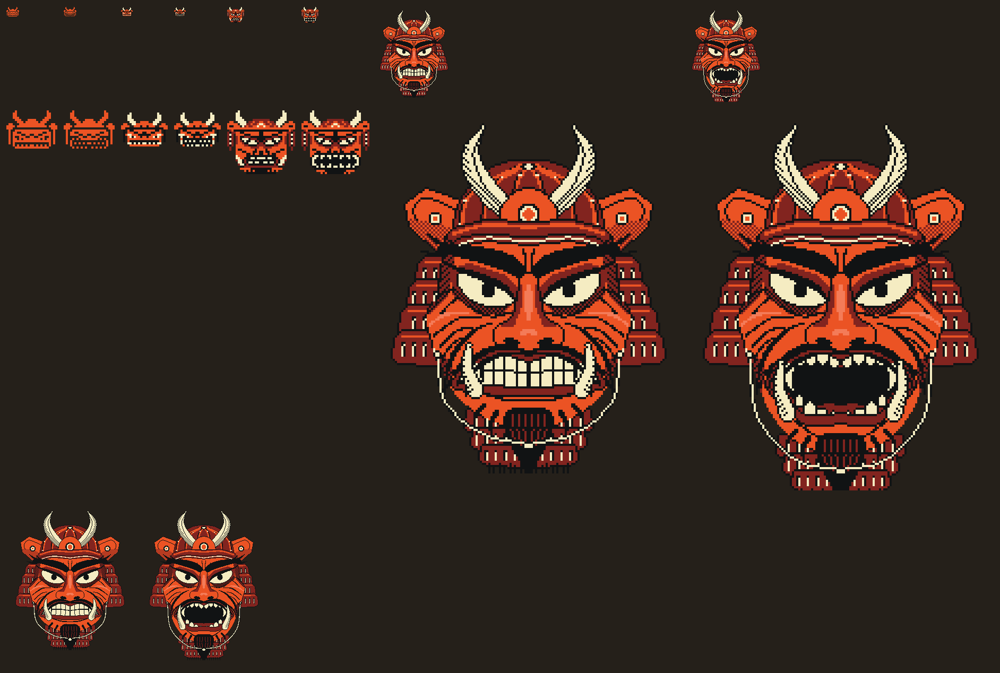
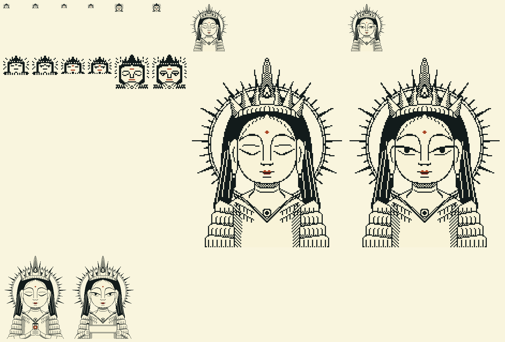

# The two heads: one character sheet

The mood's head is the desktop's face: a samurai demon by night, a warrior goddess by day. Each is one
character at every size. No size is a reduction of another: the small ones are pixels by hand
(`art/heads.txt`), the large ones brush strokes drawn at their own size (`tools/build-heads.py`),
because a line that is right at 144 px is wrong at 22.

Each sheet: the sizes as the screen shows them above, four times larger below, then the lock's size
as the lock's frames draw it.

## What the owner asked

"Less colours, more conventional, more RED; monotone, classic Japanese" (4 Nov, 17:00, 17:02), then
"more detailed, more badass, samurai style, EPIC, the fetch icons too" (17:16). Both at once: so the
detail is in the line, not in more colours, as a woodblock's is. A few blocks; sumi line and hatching.

## Who they are

**The demon.** A samurai of the red companies (akazonae): armour all in red lacquer, with an oni's face
as its mask. Kuwagata horns of ringed bone on the front plate, a ribbed helmet bowl, wings folded back
(fukigaeshi), a neck guard of laced lames (shikoro), a throat guard under the chin (yodarekake), the
cord tied beneath it. Sumi brows like flames, knotted over the nose; small hard pupils under a heavy
lid; a heavy moustache (hige) and a pointed beard; folds cut from the nose round the mouth; two tusks.
His two states are the temple guardians' pair, A-Un: 吽 the teeth locked and 阿 the roar.

**The angel.** Marishiten (摩利支天), goddess of light, the samurai's own guardian. Frontal and calm: a
gofun face, sumi hair with the fine strands carved at the brow (kewari), a red urna and small red lips, a
nimbus of blades, a war-crown with a tall blade and a flaming jewel (hōju), laced armour matching his.
Her two states: eyes closed, or open.

## Inks

Every ink is a palette token. The fewer the smaller the size.

| | the demon | the angel |
|---|---|---|
| key line, hatching, hair | sumi `lo` | sumi `strong` |
| the mass | the seal's red `accent` | gofun `key` (the tile's paper at the bar's size) |
| its shade, from 32 px | deep shu `accent_lo` | |
| its light, large sizes only | lit shu `accent_hi`, on ridges only | |
| bone | bone `strong`: horns, teeth, eyes, lacing | |
| the one accent | | shu `accent`: urna, lips; `select` under the lip, large sizes only |

Gold belongs to the lock's world (the flames behind her, the mist), never to the figure.

## Sizes

| name in the sheet | size | where it shows | inks | how it is made |
|---|---|---|---|---|
| `*.prompt.*` | 24 × 20 | the prompt's first block: two glyphs of Sumi Icons Term, 16 + 8 px | 1, the rest negative space | by hand |
| `*.bar.*` | 22 × 20 | the bar's end tile, `face.png` and `face-open.png`; the ink inside rows 2–17, 2 px of air | 2–3 | by hand |
| `*.32.*` | 32 × 32 | free for a menu's head | 3–4 | by hand |
| fetch | 144 × 180 | `fetch`, a sixel `head.six`: 18 cells × 9 lines beside its eight facts | 3–5 | brush, line 1 px |
| lock | 240 wide | the lock's scene, five frames of the gate | 4–5 | brush, line 1 px, `tools/build-lock.py` places it |

## The states, and when they show

- The bar: teeth locked / eyes closed at rest; roaring / eyes open while quick settings is open.
- The prompt: the same at rest; roaring / eyes open when the last command failed.
- The lock: at rest as above. Dark, his mouth opens over five frames and the password glows in it. Light,
  the sealed sutra in her hands unrolls over five frames, her eyes opening at the middle one, and each
  character is brushed on its paper; it rolls up again when she has it. His quote 口は禍の門 is "the mouth
  is the gate of misfortune"; hers, 言わぬが花, "better left unsaid".

## Rebuilding

    python3 tools/build-heads.py --sheet docs/art   # the outputs, and these sheets
    python3 tools/build-icons.py                    # the fonts, since the prompt's glyphs live there
    python3 tools/build-lock.py                     # the lock's frames, if the large drawings changed

`tests/static/test_heads.sh` holds the sheet to its sizes, its air, its ink counts and its mirror, and
everything made from it to what it makes.
