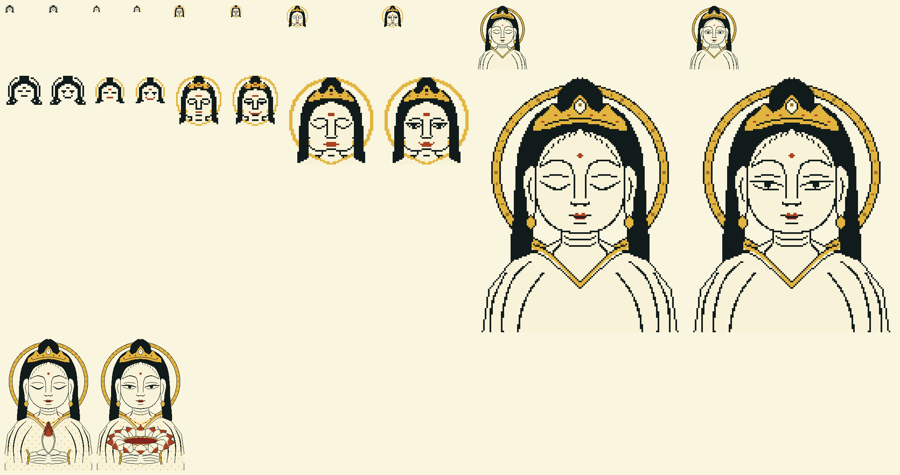

# The two heads: one character sheet

The mood's head is the desktop's face: an oni by night, a Kannon by day. Each is one character at
every size. No size is a reduction of another: the small ones are pixels by hand
(`art/heads.txt`), the large ones brush strokes drawn at their own size (`tools/build-heads.py`),
because a line that is right at 128 px is wrong at 22.

Each sheet: the sizes as the screen shows them above, four times larger below, then the lock's size
as the lock's frames draw it.

## Who they are

**The oni.** A red mask facing you, after Noh's demon masks: shikami's grimace, the teeth locked,
and tobide's open mouth. Horns of ringed bone, brows like flames knotted over the nose, small hard
pupils under a heavy lid, flat flaring nostrils, folds cut from the nose round the mouth, two tusks
from the lower jaw. His two states are the temple guardians' pair, A-Un: 吽 shut and 阿 open.

**The Kannon.** Frontal and calm, after Buddhist painting: a gofun face, sumi hair with its top-knot,
a crown of three gold peaks, long-lobed ears, a red urna and small red lips, the fine carved strands
(kewari) where hair meets brow, a ring of gold behind the head. Her two states: eyes closed, or half
open with the gaze lowered.

## Inks

The owner, 4 Nov: "less colours, more conventional, more RED; monotone, classic Japanese". So a head
is a woodblock's few blocks, and the fewer the smaller it is. Every ink is a palette token.

| | the oni | the Kannon |
|---|---|---|
| key line and hair | sumi `lo` | sumi `strong` |
| the mass | the seal's red `accent` | gofun `key` (the paper at the bar's size) |
| its shade, from 32 px | deep shu `accent_lo` | |
| its light, large sizes only | lit shu `accent_hi`, on ridges only | |
| bone and gold | bone `strong`: horns, teeth, eyes | gold `gold`: ring, crown, ear drops |
| the one accent | | shu `accent`: urna, lips; `select` under the lip, large sizes only |

## Sizes

| name in the sheet | size | where it shows | inks | how it is made |
|---|---|---|---|---|
| `*.prompt.*` | 24 × 20 | the prompt's first block: two glyphs of Sumi Icons Term, 16 + 8 px | 1, the rest negative space | by hand |
| `*.bar.*` | 22 × 20 | the bar's end tile, `face.png` and `face-open.png`; the ink inside rows 2–17, 2 px of air | 3 | by hand |
| `*.32.*` | 32 × 32 | free for a menu's head | 4 | by hand |
| `*.56.*` | 56 × 56 | quick settings' middle, `face-big.png` | 4 | by hand |
| fetch | 128 × 160 | `fetch`, a sixel `head.six`: 16 cells × 8 lines beside its eight facts | 4–5 | brush, line 1 px |
| lock | 216 wide | the lock's scene, five frames of the gate | 5–7 | brush, line 1 px, `tools/build-lock.py` places it |

## The states, and when they show

- The bar: shut at rest, open while quick settings is open.
- The prompt: shut, open when the last command failed.
- The lock: shut at rest. Dark, his mouth opens over five frames and the password glows in it. Light,
  the lotus in her hands opens over five frames, her eyes opening at the middle one, and the password
  lies in its heart. Her quote 言わぬが花 means "not saying is the flower"; his 口は禍の門, "the mouth
  is the gate of misfortune".

## Rebuilding

    python3 tools/build-heads.py --sheet docs/art   # the outputs, and these sheets
    python3 tools/build-icons.py                    # the fonts, since the prompt's glyphs live there
    python3 tools/build-lock.py                     # the lock's frames, if the large drawings changed

`tests/static/test_heads.sh` holds the sheet to its sizes, its air, its ink counts and its mirror, and
everything made from it to what it makes.
